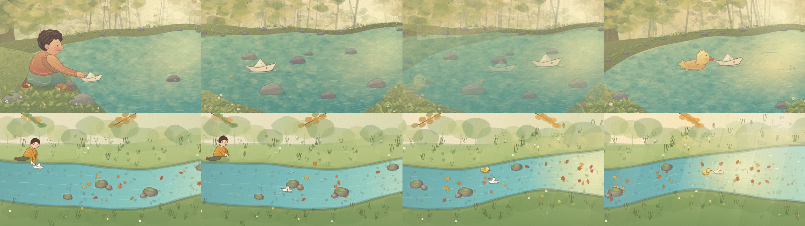
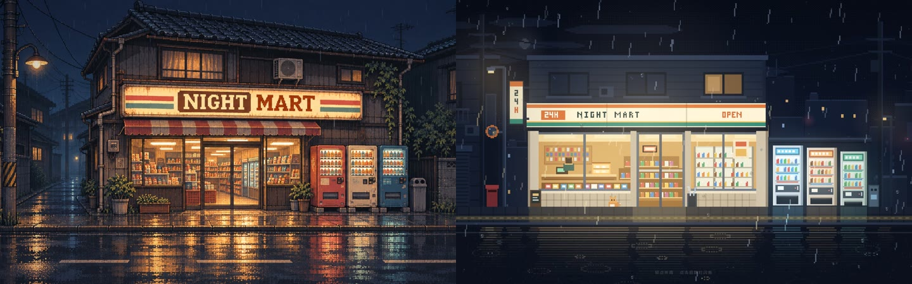
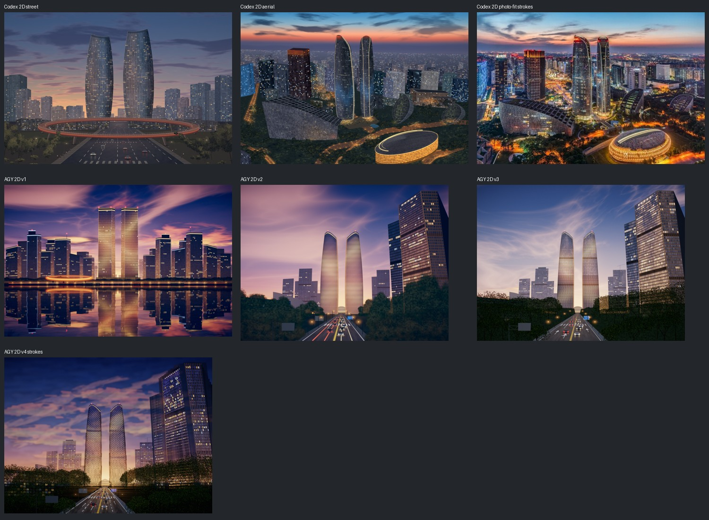

# AI 程序化图像与视频实验

用实际作品比较 Codex 和 AGY 的二维绘画、三维渲染和视频动效。每轮实验保留源码、复现说明和原始输出。

## 2026 年 11 月 26 日 · 3D 浮空岛交互场景


Codex 的《云屿》与 AGY 的《浮云秘境》，均使用 Three.js 实时构建低多边形 3D 浮空岛、瀑布、小屋与云海，支持昼夜切换与自由旋转缩放，并打包为可离线双击打开的单文件 HTML。

[两套网页、截图与源码](floating-island/README.md) · [Codex 单文件网页](floating-island/codex/index.html) · [AGY 单文件网页](floating-island/agy/floating-island.html)

## 2026 年 11 月 26 日 · 纸船动画



[两套短片、关键帧与源码](paper-boat-animation/README.md) · [Codex 成片](paper-boat-animation/codex/paper-boat.mp4) · [AGY 成片](paper-boat-animation/agy/paper_boat_story.mp4)

## 2026 年 11 月 26 日 · 智能爆炸演示

Codex 的《智能爆炸》与 AGY 的《EVENT HORIZON》。收录互动网页、PowerPoint、源码、美术资产及两套关键页预览。

[两套演示、预览与源码](intelligence-explosion/README.md) · [Codex 网页预览](intelligence-explosion/previews/codex-web.jpg) · [AGY 网页预览](intelligence-explosion/previews/agy-web.jpg)

## 2026 年 11 月 26 日 · 粒子宇宙


Codex 的《引力余晖》和 AGY 的《AETHERIA》使用 p5.js 实时绘制星尘、光轨和交互星爆。

[两套网页、截图、源码和运行说明](particle-universe/README.md)

## 2026 年 11 月 26 日 · 雨夜便利店网页实验



Codex 的《雨停之前》与 AGY 的《深夜街角 · 24H》网页。保留可打开的 HTML、源码、美术素材和效果截图。

[两套网页、截图与素材](rainy-convenience-store/README.md)

## 2026 年 11 月 25 日 · 南京折叠纸地图动画

Codex 用 Three.js 制作 55 秒竖屏短片。南京地标在同一张地图上依次立起，镜头沿路线移动，最后拉升至烟花夜景。

[关键帧总览](nanjing-paper-map/previews/keyframes-overview.jpg) · [成片 MP4](nanjing-paper-map/outputs/Nanjing.mp4) · [源码、素材与复现说明](nanjing-paper-map/README.md) · [最初的提示词](nanjing-paper-map/PROMPT.md)

## 2026 年 11 月 25 日 · ChatGPT 四周年动效视频

同一条提示词分别交给 Codex 和 AGY。Codex 用 Python 绘制中文时间线，AGY 用网页 Canvas 绘制英文动效。两版都按音乐节拍逐帧作画，导出为 1080p MP4。

[两支成片、抽帧对照、源码与复现说明](chatgpt-anniversary/README.md)

## 2026 年 11 月 25 日 · 二维绘画



| 项目 | 方法 | 成图和源码 |
| --- | --- | --- |
| **Codex** · C# / System.Drawing | 首版按建筑资料画街景；航拍版目测参考照重画构图；笔触版从照片读取色彩与边缘，保留能降低色差的笔触。 | [街景](codex-2d/Chengdu-Dusk.png) · [航拍对照](codex-2d/aerial-study/Chengdu-Aerial.png) · [笔触重绘](codex-2d/stroke-study/Chengdu-Brushes.png) · [源码与说明](codex-2d/) · [项目总结](codex-2d/Chengdu-Dusk-Project-Review.md) |
| **AGY** · Python / NumPy / Pillow / SciPy | 用二维构图、透视线和程序规则绘制城市。v4 用多毛笔刷分层画天空、楼宇和街景，再做泛光和调色。 | [v1](agy-2d/output/chengdu_twin_towers_dusk.png) · [v2](agy-2d/output/chengdu_twin_towers_dusk_v2.png) · [v3](agy-2d/output/chengdu_twin_towers_dusk_v3.png) · [v4](agy-2d/output/chengdu_twin_towers_dusk_v4.png) · [源码与说明](agy-2d/) |

Codex 笔触版的拟合目标是一张 1200 × 800 的实拍航拍照。画笔参数保存在仓库里，离线可以重放。原始参考照片由 ANTARA 刊载，仓库保留来源链接。[参考来源与笔触复现](codex-2d/stroke-study/README.md)

AGY v4 用程序决定楼形、窗灯、天空与道路的颜色和位置。两边的参考输入、构图和机位不同。要比较两套方法，需要固定参考、机位和素材条件。

## 2026 年 11 月 24 日 · 三维渲染

| 项目 | 创作工具与方法 | 从哪里开始看 |
| --- | --- | --- |
| **Codex** · 隔湖远眺，4800 × 3200 | JavaScript 生成三角网格，WebGL 2 光栅化，GLSL 实现材质与湖面倒影 | [原图](codex-webgl/Chengdu-Financial-City-at-Dusk.png) · [源码](codex-webgl/source/) · [复现说明](codex-webgl/source/README.md) |
| **AGY** · 交子之环与双塔灯光，3840 × 2160 | Python 生成 PLY 网格和贴图，Mitsuba 3 用 CPU 做路径追踪，Python 做后期 | [原图](agy-mitsuba/outputs/chengdu_twin_towers_dusk_4k.png) · [四版草稿](previews/agy-review-iterations.jpg) · [源码](agy-mitsuba/src/) · [复现说明](agy-mitsuba/README.md) |

## Codex 成图


[codex-webgl/source/render.mjs](codex-webgl/source/render.mjs) 是导出入口。[scene.js](codex-webgl/source/scene.js) 创建三维场景，[renderer.js](codex-webgl/source/renderer.js) 设置相机、进行光栅化和镜面渲染，[shaders.js](codex-webgl/source/shaders.js) 控制材质、水面和调色。原交付的源码 ZIP 也保存在该目录下。

## AGY 成图


[agy-mitsuba/render.py](agy-mitsuba/render.py) 是导出入口。[geometry.py](agy-mitsuba/src/geometry.py) 生成几何，[scene.py](agy-mitsuba/src/scene.py) 组装场景并调用 Mitsuba，[postprocess.py](agy-mitsuba/src/postprocess.py) 负责后期。[assets/](agy-mitsuba/assets/) 保留网格、贴图及 HDR 环境数据，[outputs/](agy-mitsuba/outputs/) 保留初稿、v2 至 v4、最终 PNG 及对应的线性渲染数据。原始草稿 PNG 为 960 × 540，当前脚本的 draft 预设是 1280 × 720。

## 保留原版，继续迭代

- 首次归档锁定在 Git 标签 [`baseline-2026-11-24`](https://github.com/liweimin/chengdu-twin-towers-3d/tree/baseline-2026-11-24)。以后即使主分支上的代码更新，仍能用该标签找到这两份原始源码和输出。
- 按 Agent 和技术路线保留目录。Codex 在 `codex-webgl/` 或 `codex-2d/` 继续，AGY 在 `agy-mitsuba/` 或 `agy-2d/` 继续。分别提交各项目的改动，便于比较。
- 新作品用带用途或版本的文件名，例如 `codex-webgl/outputs/camera-slide-v1.mp4` 或 `agy-mitsuba/outputs/camera-slide-v1.mp4`。把运行命令、相机或渲染参数及对应输出写进项目说明，方便回看和复现。
- 继续学习时可以先复用其中一个场景做 5 秒镜头。Codex 版可以延续 WebGL 相机和网页预览。AGY 版可以用 Mitsuba 逐帧渲染，也可以把已有网格和贴图整理成网页可加载的资产，再做交互相机和材质适配。

## 本地学习

建议通过 git clone 获取完整工作副本。Windows 本地目录可使用 D:/00容器/00/chengdu-twin-towers-3d。两个原始项目各自保留，后续实验可在仓库中新建分支，或在对应项目下继续工作。

```powershell
git clone https://github.com/liweimin/chengdu-twin-towers-3d.git 'D:/00容器/00/chengdu-twin-towers-3d'
```
