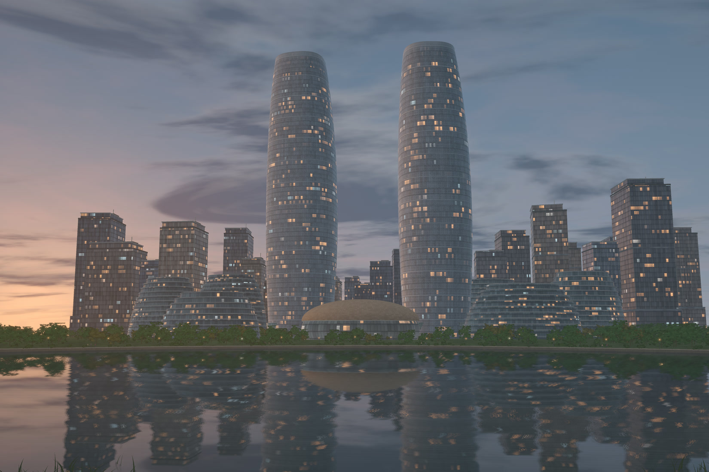

# 成都金融城双塔 · 两种程序化 3D 创作

用同一个建筑主题比较 Codex 和 AGY 的程序化建模、渲染与后期。这是 2026 年 11 月 24 日的静态图项目归档，供继续学习和迭代。

| 项目 | 创作工具与方法 | 从哪里开始看 |
| --- | --- | --- |
| **Codex** · 隔湖远眺，4800 × 3200 | JavaScript 生成三角网格，WebGL 2 光栅化，GLSL 实现材质与湖面倒影 | [原图](codex-webgl/Chengdu-Financial-City-at-Dusk.png) · [源码](codex-webgl/source/) · [复现说明](codex-webgl/source/README.md) |
| **AGY** · 交子之环与双塔灯光，3840 × 2160 | Python 生成 PLY 网格和贴图，Mitsuba 3 用 CPU 做路径追踪，Python 做后期 | [原图](agy-mitsuba/outputs/chengdu_twin_towers_dusk_4k.png) · [四版草稿](previews/agy-review-iterations.jpg) · [源码](agy-mitsuba/src/) · [复现说明](agy-mitsuba/README.md) |

## Codex 成图



[codex-webgl/source/render.mjs](codex-webgl/source/render.mjs) 是导出入口。[scene.js](codex-webgl/source/scene.js) 创建三维场景，[renderer.js](codex-webgl/source/renderer.js) 设置相机、进行光栅化和镜面渲染，[shaders.js](codex-webgl/source/shaders.js) 控制材质、水面和调色。原交付的源码 ZIP 也保存在该目录下。

## AGY 成图


[agy-mitsuba/render.py](agy-mitsuba/render.py) 是导出入口。[geometry.py](agy-mitsuba/src/geometry.py) 生成几何，[scene.py](agy-mitsuba/src/scene.py) 组装场景并调用 Mitsuba，[postprocess.py](agy-mitsuba/src/postprocess.py) 负责后期。[assets/](agy-mitsuba/assets/) 保留网格、贴图及 HDR 环境数据，[outputs/](agy-mitsuba/outputs/) 保留初稿、v2 至 v4、最终 PNG 及对应的线性渲染数据。原始草稿 PNG 为 960 × 540，当前脚本的 draft 预设是 1280 × 720。

## 保留原版，继续迭代

- 首次归档锁定在 Git 标签 [`baseline-2026-11-24`](https://github.com/liweimin/chengdu-twin-towers-3d/tree/baseline-2026-11-24)。以后即使主分支上的代码更新，仍能用该标签找到这两份原始源码和输出。
- 延续两个目录名来标明项目归属。修改哪一套，就在对应目录提交源码；跨项目对比可以分别提交，便于查看各自变化。
- 新作品用带用途或版本的文件名，例如 `codex-webgl/outputs/camera-slide-v1.mp4` 或 `agy-mitsuba/outputs/camera-slide-v1.mp4`。把运行命令、相机或渲染参数及对应输出写进项目说明，方便回看和复现。
- 继续学习时可以先复用其中一个场景做 5 秒镜头。Codex 版可以延续 WebGL 相机和网页预览。AGY 版可以用 Mitsuba 逐帧渲染，也可以把已有网格和贴图整理成网页可加载的资产，再做交互相机和材质适配。

## 本地学习

建议通过 git clone 获取完整工作副本。Windows 本地目录可使用 D:/00容器/00/chengdu-twin-towers-3d。两个原始项目各自保留，后续实验可在仓库中新建分支，或在对应项目下继续工作。

```powershell
git clone https://github.com/liweimin/chengdu-twin-towers-3d.git 'D:/00容器/00/chengdu-twin-towers-3d'
```
