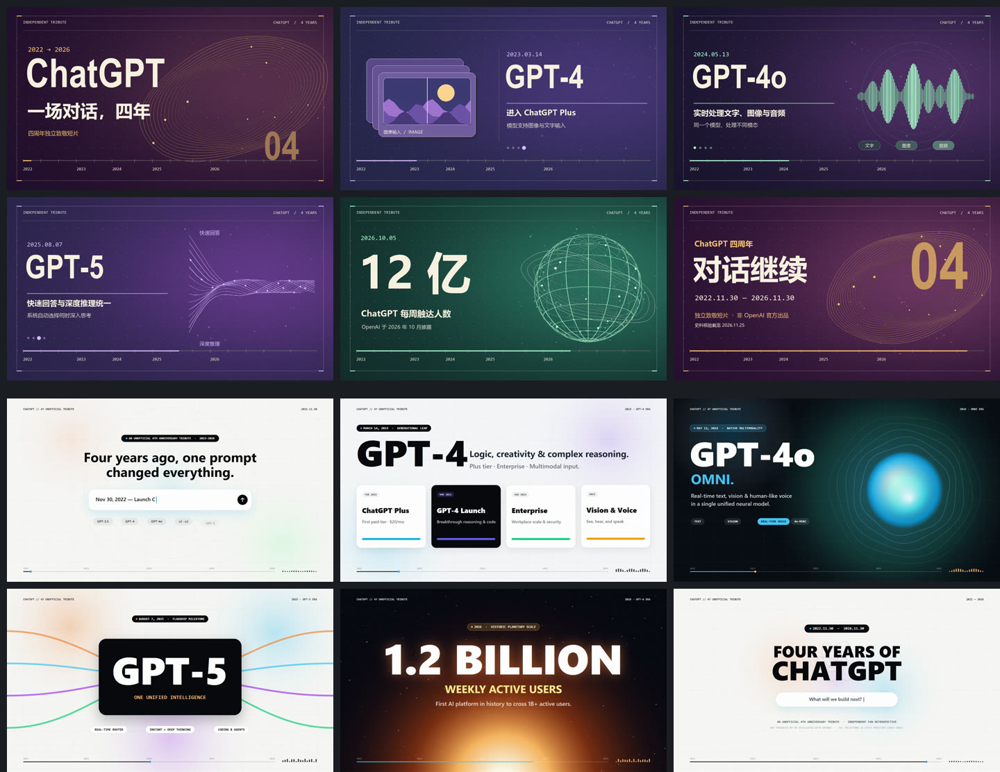

# ChatGPT 四周年 · 两支独立致敬短片

两支片均为第三方创作，使用程序绘制画面与合成配乐。片尾的 2026 年 11 月 30 日为纪念日期。下面的抽帧图上半部为 Codex，下半部为 AGY。



| 版本 | 成片 | 实现与复现 |
| --- | --- | --- |
| **Codex** · 中文《一场对话，四年》 | [MP4，52.8 秒](codex/ChatGPT%20四周年｜一场对话，四年.mp4) | [Python 源码](codex/source/render.py) · [复现说明](codex/source/README.md) · [史料与视觉参考](codex/ChatGPT%20四周年｜史料与视觉参考.md) |
| **AGY** · 英文《Four Years of ChatGPT》 | [MP4，50 秒](agy/chatgpt_4th_anniversary_tribute.mp4) | [Canvas 2D](agy/scene.html) · [导出代码](agy/render.js) · [音乐合成](agy/generate_audio.js) · [WAV](agy/soundtrack.wav) · [原工程预览帧](agy/preview_frames/) |

两支 MP4 均为 1920 × 1080、30 fps，视频为 H.264，音频为立体声 AAC。Codex 的独立 WAV 可由脚本生成，AGY 的 WAV 随交付一并保留。

## 逐帧动画与音乐

- **Codex** 用 `SCENES` 数组决定各镜头从第几拍开始。Pillow 在 1280 × 720 画布逐帧绘制标题、卡片、粒子和线框，再把 1,584 帧 RGB 数据传给 FFmpeg 放大到 1080p 并编码。NumPy 按 150 BPM 合成鼓、低音和旋律，镜头切点附近加入过渡音与重音。
- **AGY** 用 HTML Canvas 2D 在 1920 × 1080 画布上按照时间画出标题、输入框、图表和光效。JavaScript 按 128 BPM 生成 WAV。画面和音轨分别使用同一小节时长，段落闪光和音效重击共用小节位置。Puppeteer 启动六个无头浏览器分段导出 1,500 张 JPEG，再由 FFmpeg 编码并合成音轨。页面载入时绘制第 0 帧，完整成片由导出脚本生成。

## 复现 AGY 版本

在 `agy/` 下使用 Node.js、可从命令行调用的 FFmpeg，以及已安装的 Chrome 或 Edge。浏览器路径由 [render.js](agy/render.js) 中的 `CHROME_CANDIDATES` 查找。为了保留归档成片，可以在单独工作副本运行。

```powershell
npm ci
node generate_audio.js
node render.js
```

## 史料说明

Codex 随片附有逐条来源。AGY 的时间线和统计数值写在 `scene.html` 中，原交付没有附逐条来源表。OpenAI 在 2026 年 9 月 29 日的 DevDay 回顾把 12 亿写作每周用户，10 月 5 日的文章写作每周触达人数。AGY 把它标为每周活跃用户，Codex 沿用了 10 月文章的表述。[DevDay 2026 回顾](https://openai.com/index/devday-2026-recap/) · [10 月 5 日 OpenAI 公告](https://openai.com/index/new-chatgpt-ads-format-and-measurement/)
