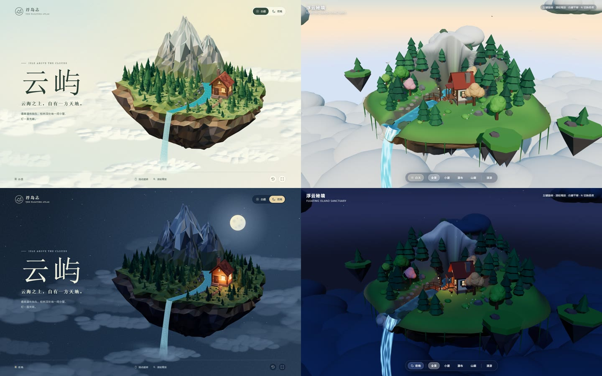

# 3D 浮空岛 · Three.js 交互场景实验

2026 年 11 月 26 日归档。两套可离线双击运行的 Three.js 3D 浮空岛互动网页，均支持昼夜切换、轨道旋转与缩放，分别保存在 `codex/` 和 `agy/`。

| Agent | 作品 | 入口与源码 | 交互能力 | 效果截图 |
| --- | --- | --- | --- | --- |
| Codex | 《云屿 · Isle Above the Clouds》 | [单文件 HTML](codex/index.html) · [场景逻辑](codex/scene.js) · [岛屿几何](codex/island.js) · [样式](codex/style.css) · [打包脚本](codex/build.mjs) | 拖拽旋转、滚轮缩放、昼夜切换、键盘方向键与重置视角、全屏。 | [白昼](previews/codex-day.jpg) · [夜晚](previews/codex-night.jpg) · [近景旋转](previews/codex-angle.jpg) |
| AGY | 《浮云秘境 · Floating Island Sanctuary》 | [单文件 HTML](agy/floating-island.html) | 左键旋转、滚轮缩放、右键平移、昼夜切换（快捷键 `N`）、4 个预设机位（全景/小屋/瀑布/山巅）、自动漫游（快捷键 `R`）。 | [白昼](previews/agy-day.jpg) · [夜晚](previews/agy-night.jpg) · [小屋特写](previews/agy-cabin.jpg) · [瀑布特写](previews/agy-waterfall.jpg) |

## 运行与复现

- **直接体验**：下载 `codex/index.html` 或 `agy/floating-island.html` 后，直接用支持 WebGL 2 的现代浏览器双击打开即可离线运行（Three.js 已内联）。
- **源码重打包（Codex）**：在 `codex/` 目录下运行 `node build.mjs`（需安装 `esbuild`），即可将 `scene.js`、`island.js`、`style.css` 与 `vendor/` 下的 Three.js 重新打包进单文件 `index.html`。
