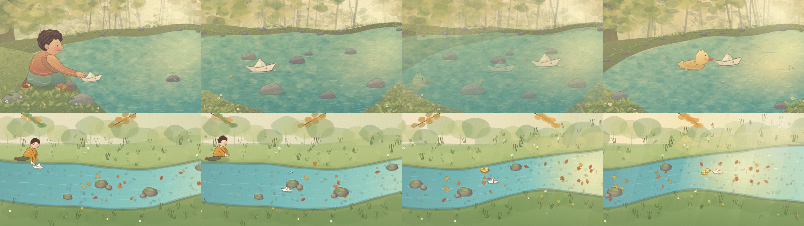

# 纸船动画 · 两套短片实验

2026 年 11 月 26 日归档。两套 12 秒左右的手绘风纸船短片，分别保存在 `codex/` 和 `agy/`。

| Agent | 成片 | 关键帧总览 | 源码与说明 |
| --- | --- | --- | --- |
| Codex | [paper-boat.mp4](codex/paper-boat.mp4) | [Codex 2×2 关键帧](previews/codex-keyframes.jpg) | [说明](codex/README.md) · [C# 源码](codex/src/) · [构建脚本](codex/build.ps1) |
| AGY | [paper_boat_story.mp4](agy/paper_boat_story.mp4) | [AGY 2×2 关键帧](previews/agy-keyframes.jpg) | [HTML 动画](agy/animation.html) · [录屏脚本](agy/render_video.mjs) · [配乐脚本](agy/generate_audio.py) |
