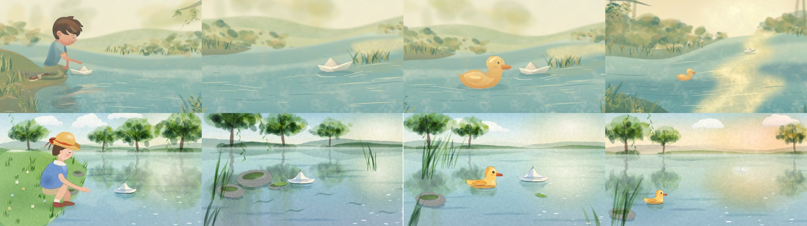

# 《纸船的故事》v2 · 水彩绘本短片（分步迭代实验）

2026 年 11 月 27 日归档。与 11 月 26 日“一次性直出”的 [paper-boat-animation](../paper-boat-animation/README.md) 不同，本轮实验采用**“导演方案 → 静态关键帧调风格 → 定稿后出 30 秒成片 → 交付离线单文件 HTML”**的协作流程，分别保存在 `codex/` 和 `agy/`。

| Agent | 成品与规格 | 关键帧预览 | 离线 HTML 机制 | 源码入口 |
| --- | --- | --- | --- | --- |
| Codex | [The-Paper-Boat.mp4](codex/film/The-Paper-Boat.mp4)（1280×720 · 24fps · 30.5s）· [离线 HTML](codex/The-Paper-Boat.html)（592 KB） | [Codex 2×2 关键帧](previews/codex-keyframes.jpg) | 画面 JS Canvas 实时绘制 + 音频 Web Audio 首次播放时现场合成（零媒体内嵌，无旁白） | [成片渲染](codex/film/render.py) · [音频合成](codex/film/sound.py) · [关键帧迭代源码](codex/side-profile/paint_keyframe.py) |
| AGY | [paper_boat_story.mp4](agy/paper_boat_story.mp4)（1600×900 · 24fps · 30.0s）· [离线 HTML](agy/纸船的故事_离线绘本影院.html)（732 KB） | [AGY 2×2 关键帧](previews/agy-keyframes.jpg) · [定稿关键帧](agy/keyframes/) | 画面 JS Canvas 实时绘制 + 含中文旁白的混音 MP3 以 Base64 内嵌 | [水彩引擎 v2](agy/watercolor_v2.js) · [角色 v2](agy/characters_v2.js) · [动画场景](agy/animate_scenes.js) · [音频合成](agy/generate_audio.mjs) · [离线打包](agy/build_offline_html.mjs) |

---

## 人与 Agent 的协作过程（最少必要总结）

两套实验从**同一条导演策划提示词**起步（要求先出 30 秒水彩绘本导演方案，再以代码绘制关键帧对齐画风，满意后再完成成片与音频，最后追加离线单文件 HTML）。

### 1. Codex 协作脉络（约 10 轮创作/交付交互）
1. **导演方案 & 初版关键帧（2 轮）**：先确定“倒影开场 → 溪草停顿 → 小鸭轻推 → 漂向阳光”的叙事，再用 Python 绘制 3 张初版水彩关键帧。
2. **人物结构与水彩笔触密集纠偏（5 轮人工反馈，后 2 轮启用 Goal 模式）**：
   - 反馈 1：整体未达惊艳，小孩下半身奇怪且只见一只手 → 重画跪姿撑石、拉开前后景颗粒层次；
   - 反馈 2：小孩姿态仍奇怪，要求自建自检迭代机制 → 改用先画关节骨架再上色；
   - 反馈 3：伸出的手更奇怪，建议自研水彩笔刷系统 → 参考 Krita 笔刷引擎实现分层笔触重画手部；
   - 反馈 4–5（Goal）：两次指出肩颈与手臂衔接怪异，要求大改且保证后续动画稳定 → 推倒旧角度，改为**侧面跪坐构图**（固定肩点与臂长，做 17 帧稳定性校验）后定稿。
3. **成片与纯代码离线 HTML（3 轮）**：一次完成 30.5 秒成片及 Python 原创配乐/音效（未加旁白，无音频返工）；将产物从 Codex 临时目录迁入项目目录后，按用户要求放弃“Base64 内嵌 MP4”，改造成 **JS Canvas 实时绘制 + Web Audio 现场合成**的 592 KB 纯离线 HTML。

### 2. AGY 协作脉络（9 轮创作/交付交互 + 3 轮原理追问）
1. **导演方案 & 水彩原理对齐（3 轮）**：提出相似的“回水湾停顿 + 小鸭轻推”叙事，先阐述水彩透明叠色与冷压纸纹原理，再用 HTML5 Canvas + 无头浏览器渲染 4 张关键帧（首轮内部自修过一版环痕与轮廓）。
2. **画风纠偏与引擎重构（3 轮人工反馈，第 3 轮启用 `/goal`）**：
   - 反馈 1：画面偏“水墨”不像水彩，小孩怪异 → 切换高明度清透水彩色板，重绘小孩与点彩树叶；
   - 反馈 2：小孩依然奇怪，要求逐笔自检 → 单独拉出人物做 3 轮特写精修（见 `agy/keyframes/child_study.png`）再放回场景；
   - 反馈 3（`/goal`）：仍觉不够好看，要求自行调研打磨至达标 → 重构为全画幅水彩引擎（天空云朵、远山空气透视、三层树冠、实时水面镜像倒影、草帽红丝带小孩），多轮审图自修后定稿。
3. **成片、音频返工与离线 HTML（3 轮）**：启用 `/goal` 渲染 720 帧高清 MP4 并合成配乐、环境音与中文旁白；用户指出结尾出现“嗡嗡”异响且缺鸭叫声 → 定位修复弦乐颤音并补鸭叫声重封装；最后打包 732 KB 离线单文件 HTML（画面 JS 实时渲染，含旁白的混音 MP3 以 Base64 内嵌）。

### 3. 协作差异速览

| 维度 | Codex | AGY |
| --- | --- | --- |
| **关键帧卡点与返工** | 5 轮人工纠偏，核心卡在**人物肩臂解剖衔接**，最终靠换侧面构图解决 | 3 轮人工纠偏，核心卡在**初版偏水墨 + 人物生硬**，最终靠重构全画幅水彩引擎解决 |
| **成片一次通过率** | 成片音画一次过（无旁白，仅原创配乐与音效） | 成片画面一次过，音频返工 1 轮（修结尾弦乐嗡嗡声 + 补鸭叫声），含中文旁白 |
| **技术路线** | Python 逐帧绘制 + Python 音频合成 → 另行移植为纯 JS/WebAudio 离线 HTML | 本身就是前端 Canvas 渲染管线 → 无头浏览器出帧 + 同一套 JS 直接打包离线 HTML |
