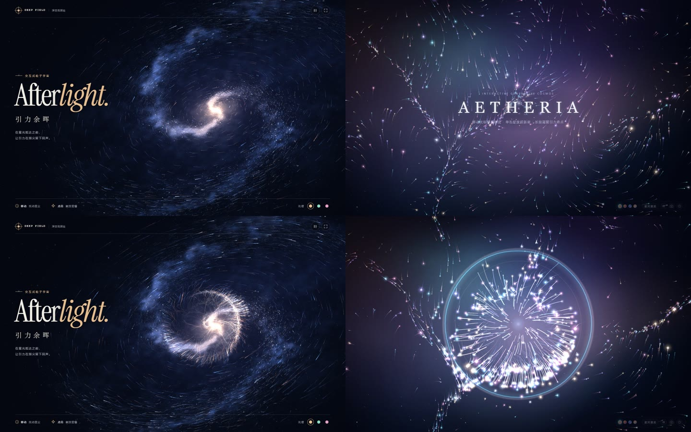

# 粒子宇宙 · p5.js 交互实验

同一主题的两套全屏网页作品。都用 p5.js 实时生成星尘、轨迹和星爆，指针移动会改变粒子运动。

| 项目 | 入口 | 交互 | 效果截图 |
| --- | --- | --- | --- |
| Codex · 引力余晖 | [网页](codex/index.html) · [原项目说明](codex/README.md) | 移动扰动星尘，点击触发星爆，三种配色，暂停和全屏。 | [默认画面](previews/codex-default.jpg) · [点击星爆](previews/codex-burst.jpg) |
| AGY · AETHERIA | [网页](agy/index.html) · [绘图与交互](agy/js/sketch.js) | 移动牵引星流，单击产生脉冲，长按后释放奇点，四种配色和三种星流，可暂停并保存画面。 | [默认画面](previews/agy-default.jpg) · [奇点释放](previews/agy-interact.jpg) |

下载后保留各自的目录结构，用浏览器打开对应的 `index.html`。p5.js 随项目提供。
