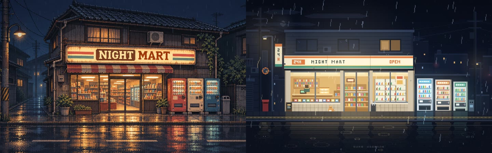

# 雨夜便利店 · 两套网页实验

2026 年 11 月 26 日归档。两套作品分别保存在 `codex/` 和 `agy/`。

| Agent | 作品 | 入口 | 效果截图 |
| --- | --- | --- | --- |
| Codex | 《雨停之前》 | [单文件 HTML](codex/before-the-rain-stops.html) · [分文件网页](codex/dist/index.html) · [美术提示词](codex/artwork-prompts.txt) | [主画面](previews/codex-before-the-rain-stops.jpg) |
| AGY | 《深夜街角 · 24H》 | [index.html](agy/index.html) · [late_night_konbini.html](agy/late_night_konbini.html) | [index.html 截图](previews/agy-index.jpg) · [late_night_konbini 截图](previews/agy-late-night-konbini.jpg) |

下载对应文件后用浏览器打开。Codex 的分文件版需要保留 `dist/` 内的脚本、样式和两张 PNG，单文件版可独立打开。
